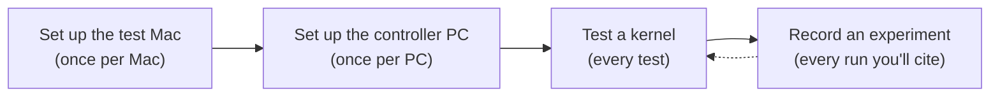

# Guides

Step-by-step instructions, in the order you'll need them. Read the
[overview](../overview.md) first if the setup is new to you.



| Guide | Use it to |
| --- | --- |
| [set-up-the-test-mac.md](set-up-the-test-mac.md) | Add the m1n1 boot entry, SSH, sudo, build tools, and kernel source to a Mac |
| [set-up-the-controller-pc.md](set-up-the-controller-pc.md) | Set up WSL, m1n1, the `asahi` tool, and USB forwarding, and boot the Mac's own kernel under the hypervisor |
| [test-a-kernel.md](test-a-kernel.md) | Build a branch on the Mac, boot it under the hypervisor, check it, and test USB-C displays |
| [recording-an-experiment.md](recording-an-experiment.md) | Turn a run into an experiment report with published evidence |
| [x86-cross-build-qemu.md](x86-cross-build-qemu.md) | Compile-check on an x86 PC and boot generic arm64 kernels in QEMU, without a Mac |

## Writing a guide

Guides are kept correct. When you change a command, run it and update the
guide's **Last verified** line. Results never go in a guide; they go in an
[experiment report](../experiments/README.md).

Every guide starts with:

```markdown
# Title

**Applies to:** hardware and kernel versions ·
**Last verified:** YYYY-MM-DD on `MAC-NN`; link to the experiment, if any
```

Then, in this order:

- one short paragraph on what the guide gets you, and what to do first;
- a small diagram of the steps, if there are more than three;
- numbered steps, with each command block labelled with where it runs
  (**Mac**, **PC**, **PowerShell**), and a one-line comment on any command
  whose purpose isn't obvious;
- a **You're done when** checklist for setup guides.

Put explanations of *why* in a sentence or two, and link to a decision or the
[tool reference](../reference/asahi-tool.md) for more. Error messages and
their fixes go in [Troubleshooting](../reference/asahi-tool.md#troubleshooting),
not in the steps.
