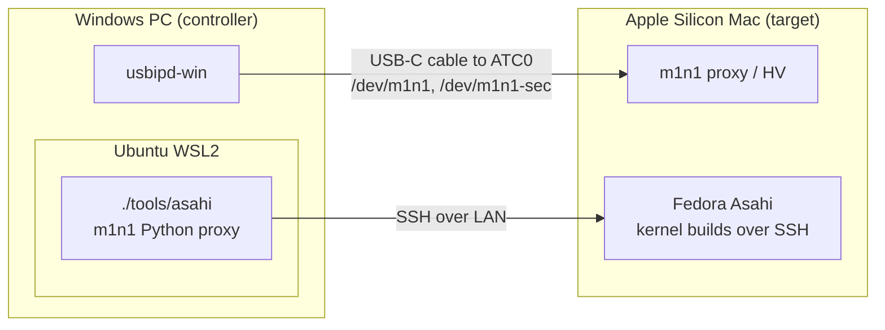

# Kernel development and m1n1 HV testing

**Applies to:** MacBook Air M2 (J413) with Fedora Asahi, fairydust 7.1.x ·
**Last verified:** 2026-10-14 on `MAC-01`; see
[2026-10-14-baseline-hv](../experiments/2026-10-14-baseline-hv/) and
[2026-10-14-tipd-oob-fixes](../experiments/2026-10-14-tipd-oob-fixes/)

This guide sets up and runs the team's kernel test loop: build a kernel on the
Mac, then boot it under the m1n1 hypervisor (HV) from a Windows PC so that a
bad kernel can never replace the Mac's working boot files. Results go in an
experiment report; see [Record an experiment](recording-an-experiment.md).



Run host commands from a checkout of the `project` branch. Kernel source
lives in a separate worktree **on the Mac**. `tools/asahi` needs Python 3.11
or newer; m1n1's Python clients run through `uv` with Python 3.13 and m1n1's
pinned dependencies.

## Prerequisites

- **A Mac that can boot m1n1 in proxy mode.** The usual way is a separate
  m1n1 boot entry made by the Asahi installer: run `curl https://alx.sh | sh`
  in macOS, enable expert mode, and choose the tethered (m1n1-only) option.
  The other way is the stage-1 proxy backdoor on the existing Asahi install;
  see [m1n1 overview](../research/m1n1-overview.md#2-install-m1n1) and the
  [Asahi tethered boot guide](https://asahilinux.org/docs/sw/tethered-boot/).
- **Ubuntu on WSL2 with systemd enabled.** `setup-host` starts
  `systemd-udevd`. Check that `/etc/wsl.conf` contains `[boot]` and
  `systemd=true`, then run `wsl --shutdown` from Windows if you changed it.
- **A data-capable USB-C cable** from the PC to the Mac's rear port (ATC0,
  next to MagSafe). The reason is recorded in
  [decision 0002](../decisions/0002-proxy-on-atc0.md).
- **m1n1 built on the PC** (default location `~/projects/m1n1`) and
  [`uv`](https://docs.astral.sh/uv/getting-started/installation/) on PATH.
- The Mac and PC on the same LAN, and the Mac kept awake during long builds
  and transfers.

## One-time setup

### 1. Prepare the Mac

Boot Asahi normally, join the same LAN as Windows, and run **on the Mac**:

```bash
sudo dnf install openssh-server
sudo systemctl enable --now sshd
whoami
hostname -I
```

If the connection times out and firewalld is active, allow its SSH service in
the appropriate LAN zone. Do not guess a different root partition or disable
the firewall globally.

Automated collection of `/boot` artifacts and staging of modules requires
noninteractive sudo. One option for a trusted development account is:

```bash
sudo visudo -f /etc/sudoers.d/99-asahi-workflow
```

Add `YOUR_USERNAME ALL=(root) NOPASSWD: ALL`, save, then check with
`sudo -k` followed by `sudo -n whoami`. This gives the account full root
access while the rule exists. Remove that file when the grant is no longer
needed. If the Mac already has an equivalent rule under another file name,
don't add a second one. Type passwords only into a local terminal; never
store them in this repository or paste them into chat tools.

### 2. Configure WSL

Run **in Ubuntu WSL**, from this project:

```bash
./tools/asahi init --target YOUR_USERNAME@MAC_IP
./tools/asahi setup-host
./tools/asahi authorize
./tools/asahi discover
./tools/asahi capture
./tools/asahi doctor --online
```

`init` creates `asahi.local.json` once. If it already exists, edit that file
instead of running `init` again. It starts from the shape in
[`asahi.example.json`](../../asahi.example.json). `authorize` creates a dedicated
Ed25519 key if necessary and uses `ssh-copy-id` to send its **public** key to
the separate Mac over the network. Enter the Mac's password when prompted.
The private key stays on the WSL host.

`setup-host` installs Ubuntu packages, the GNU ARM64 cross toolchain, and the existing m1n1 udev rules. It
starts `systemd-udevd.service`, not `udev.service`. If it adds you to `dialout`,
restart your login session before opening serial devices.

The default m1n1 location is `~/projects/m1n1`. Supply `--m1n1-dir` to `init`
or edit the config for a different path. Build m1n1 according to its
[user guide](https://asahilinux.org/docs/sw/m1n1-user-guide/). `uv` must also
be available on PATH; its official installation instructions are at
<https://docs.astral.sh/uv/getting-started/installation/>.

m1n1's Python proxy tools assemble ARM64 stubs at runtime; a prebuilt m1n1
binary alone is insufficient. `doctor`, `boot`, and `proxy` now assemble and
link a small stub before accessing the primary port. Fresh setup uses the
GNU cross tools. An existing Clang/LLD installation can instead be selected
in `asahi.local.json`, for example:

```json
"proxy_env": {
  "USE_CLANG": "1",
  "TOOLCHAIN": "/usr/lib/llvm-22/bin/",
  "LLDDIR": "~/.local/lld-shim/"
}
```

Set `LLDDIR` to the directory containing your working `ld.lld`; the original
controller PC uses a rust-lld shim there. The preflight validates clang, linker,
objcopy, and nm together. These host settings are separate from the remote
kernel build's `make_args`.

`hv_heap_mib` defaults to 512 in the host config. The upstream HV loader
normally reserves a 128 MiB Python-managed upload heap; a larger compressed
initramfs can exceed it. The project launcher runs the upstream helper with
a scoped Python shim that raises this allocation for `run_guest.py`, without
editing m1n1. The accepted range is 128–2048 MiB, and the chosen value is saved
in `boot.json`. Increasing it reserves more target RAM before the guest starts.

`discover` records the real root UUID, Btrfs subvolume, EFI partition UUID,
board, and boot arguments via SSH. `capture` downloads the running kernel's
boot artifacts and creates a checksum manifest in `.asahi/bundles/`. Every
new capture has its own directory, so the initial baseline is retained.
If you already transferred a bundle, `./tools/asahi adopt hv-bundle` can reuse
it against the checksums saved by `discover`. That path works offline after
discovery and refuses mismatched kernel, initramfs, symbols, or target DTB.
If the old transfer omitted `.config`, the manifest records the required
configuration options verified over SSH instead; it does not invent a full
build configuration. Native builds still require a real `.config` in their
remote build directory.
Copy a dedicated SSH key only through a channel you control; a missing file
in another terminal is diagnosed by comparing HOME/project paths with `doctor`.

### 3. Prepare Windows USB forwarding

In **Windows PowerShell**, install usbipd-win if necessary:

```powershell
winget install --interactive --exact dorssel.usbipd-win
usbipd list
```

While the Mac is in proxy mode, identify `1209:316d` and note its BUSID.
Share it once in **Administrator PowerShell**:

```powershell
usbipd bind --busid YOUR_BUSID
```

Set `usb_busid` in `asahi.local.json` to that value (for example `"3-6"`).
This lets forwarding wait for a currently disconnected Mac. Keep the cable
on the same Windows USB port. Recheck `usbipd list` if you move it.
The wrapper only targets m1n1, never an arbitrary first USB device.

Forwarding can then be started **in a separate WSL terminal**:

```bash
./tools/asahi usb attach
```

Leave it running. It invokes Windows usbipd with `--auto-attach --unplugged`
to reconnect through target resets. `usb list`, `usb bind`, and `usb detach`
are also available; `bind` needs Windows elevation. `usb attach --once`
performs a single attachment. See the
[usbipd WSL guide](https://github.com/dorssel/usbipd-win/wiki/WSL-support).

## First hardware test: boot the baseline under HV

Keep Windows USB forwarding running. Close any older picocom/m1n1 clients;
one process should own each serial port. The primary `/dev/m1n1` is for
proxy/HV control; `/dev/m1n1-sec` is the guest's serial console.

From the WSL project:

```bash
./tools/asahi boot --dry-run
./tools/asahi session start
./tools/asahi session attach
```

`session start` creates tmux windows named `serial` and `hv`. The UART
recorder waits for USB, and the launcher waits up to 180 seconds for both
the proxy and the recorder. Boot the Mac into its m1n1 proxy entry (see
[Prerequisites](#prerequisites)) during that interval. Use `--wait 600` if you need longer.
The normal Asahi boot entry is not converted into a permanent test entry.

For installations using m1n1's optional stage-1 backdoor, opening a serial
port during the initial five-second window interrupts normal boot. That
mode requires one-time recovery setup described in the
[Asahi tethered boot guide](https://asahilinux.org/docs/sw/tethered-boot/).
The tools do not change recovery security settings or boot policy.

In tmux, `Ctrl-b n` switches windows; `Ctrl-b d` detaches and leaves both
controllers running. Closing your terminal does not stop tmux. Keep WSL and
the Windows forwarding process alive. Stopping the HV controller while the
guest runs can leave the guest stuck at its next trap.

After Linux boots, **in another WSL terminal**:

```bash
./tools/asahi check --wait 120
./tools/asahi logs
```

The check requires the exact launch identifier from `/proc/cmdline`, the
expected kernel release, the configured root UUID, matching on-disk modules,
and active SSH. Thus SSH to the previous normal boot cannot accidentally
pass as the HV test. Kernel errors and failed systemd services are collected
in `guest-health.log` for review; the basic PASS does not certify every driver.
If DHCP changes the address, edit `target` in `asahi.local.json` and retry.

When the Mac powers off or its USB link drops, the HV controller exits with
`SerialException: device reports readiness to read but returned no data`
and the run's `boot.json` shows `"state": "exited"`. At the end of a run that
is expected. In the middle of a run it means the USB link was lost; check the
cable and the usbipd window.

The guest uses the **same installed Asahi root filesystem and user data**.
HV is a hardware debugging environment, not a separate VM disk. The launch
keeps the ordinary root arguments and adds serial logging, `nokaslr` for
symbols, and a run identifier. `bootargs` in the local config can override
the inferred command line when an experiment needs it.

## Develop, build, stage, test

For fetching a development branch at a pinned commit and testing USB-C/DP,
follow [the branch testing guide](branch-hv-testing.md). It includes the J413
driver profile, initramfs inclusion, port selection, and live binding checks.

### Install native kernel build dependencies on the Mac

Kernel compilation in this workflow happens **on the ARM64 Mac over SSH**.
The WSL cross tools described above serve m1n1's host proxy. Installing them
does not prepare the Mac's native kernel build environment.

Run these commands **in the Mac SSH shell**, on Fedora Asahi:

```bash
sudo dnf install gcc make clang llvm lld clang-libs \
  bison flex bc openssl-devel elfutils-libelf-devel dwarves \
  perl python3 git pkgconf-pkg-config \
  zstd xz kmod dracut cpio diffutils findutils tar rsync
```

`dwarves` supplies `pahole` for the baseline's BTF debug information;
`clang-libs` supplies libclang for Rust bindgen. `openssl-devel` supports
module signing. For interactive `make menuconfig`, also install
`ncurses-devel`; the automated `olddefconfig` build does not need that UI.
These packages cover the current baseline configuration; enabling additional
kernel features can introduce additional build tools.

The baseline enables Rust. For a new Fedora toolchain setup, install:

```bash
sudo dnf install rust rust-src bindgen-cli
```

If `command -v rustc` selects a rustup compiler under `~/.cargo/bin`, the
Fedora `rust-src` package does not supply that compiler's standard-library
sources. Use the matching rustup component instead, from the chosen kernel
source/build directory:

```bash
rustup component add rust-src
```

The first successful native build used Clang/LLD **22.1.8**, rustup
**rustc 1.99.0**, bindgen **0.72.1**, and pahole **1.32** on Fedora 44,
from source commit `ce9f2eba72c061a50b2d790450e90af3439d8c24`
([experiment](../experiments/2026-10-14-baseline-hv/)).
These are the tested versions, not universal minimums. That source's
`scripts/min-tool-version.sh` reports LLVM 15.0.0, rustc 1.85.0, and bindgen
0.71.1 as minimums. Recheck the script and
`Documentation/process/changes.rst` when changing kernel revisions.

Verify the selected toolchain **in the Mac kernel directory**:

```bash
command -v clang ld.lld rustc bindgen pahole
clang --version
ld.lld --version
rustc --version
bindgen --version
pahole --version
make LLVM=1 rustavailable
```

The Rust preflight checks the selected compiler, library sources, bindgen,
and libclang together. Fix reported errors before building. Use the same
`LLVM=1` setting for configuration and compilation. See the upstream
[LLVM build guide](https://docs.kernel.org/kbuild/llvm.html) and
[Rust setup guide](https://docs.kernel.org/rust/quick-start.html) for alternate
toolchain layouts. The current workflow has tested native builds; it does
not yet automate cross-compiling the kernel in WSL.

### Prepare a development worktree on the Mac

Open a shell from WSL:

```bash
./tools/asahi ssh
```

Then **in that Mac SSH shell**:

```bash
git -C ~/linux-fairydust worktree add -b work/usb ~/kernel-usb HEAD
cp ~/linux-fairydust/.config ~/kernel-usb/.config
exit
```

Edit the kernel worktree using your normal editor/remote workflow. Keep
upstream-tracking branches unchanged. The `project` branch here contains
documentation and tools, not kernel source. Inspect applicable instructions
in the chosen source tree before changing it.

### Preserve the Mac's working kernel configuration

Start from the **known working Asahi/fairydust `.config`**, as copied above.
For the same installed baseline, `/boot/config-$(uname -r)` is another
source. A full captured baseline also preserves `.config` in its WSL bundle.
Use the matching Asahi/fairydust source revision as the starting point; an
arbitrary upstream revision may lack drivers used by this Mac. This source
tree has no `arch/arm64/configs/asahi_defconfig`, so do not rely on that target.
It does have the fragment `arch/arm64/configs/asahi.config`
(`make LLVM=1 defconfig asahi.config`), which is how the
[x86 cross-build guide](x86-cross-build-qemu.md) configures a kernel. A
fragment-built config is not identical to the installed baseline, so prefer
the baseline `.config` for anything you will boot.

The following are checkpoints in the current J413/M2 configuration, **not
a complete replacement for its saved `.config`**:

| Area | Working configuration and requirement |
| --- | --- |
| Architecture | `CONFIG_ARCH_APPLE=y`, `CONFIG_ARM64_16K_PAGES=y`; keep the 16 KiB page configuration. |
| Initramfs | `CONFIG_BLK_DEV_INITRD=y`, `CONFIG_RD_ZSTD=y`; the current generated initramfs uses Zstandard. Keep the decoder for the compression actually used. |
| Serial boot/debug | `CONFIG_SERIAL_SAMSUNG=y`, `CONFIG_SERIAL_SAMSUNG_CONSOLE=y`; keep the baseline's early console support. |
| Modules/devices | `CONFIG_MODULES=y`, `CONFIG_DEVTMPFS=y`, `CONFIG_DEVTMPFS_MOUNT=y`. |
| Root storage | `CONFIG_NVME_APPLE=m`, `CONFIG_NVME_CORE=m`, `CONFIG_BLK_DEV_NVME=m`, `CONFIG_BTRFS_FS=y` in this baseline. Required storage modules and their dependencies must be in the matching initramfs. |
| SSH networking | `CONFIG_BRCMFMAC=m`, `CONFIG_BRCMFMAC_PCIE=y`, `CONFIG_PCI=y`, `CONFIG_PCIE_APPLE=y`, and `CONFIG_FW_LOADER=y`; preserve the installed Wi-Fi firmware. |
| Apple platform | Preserve the baseline's clocks, power domains, interrupt controller, mailbox/RTKit, DART, pinctrl, and other Apple driver selections. Some are modules; copying a few options is insufficient. |
| Rust drivers | Keep `CONFIG_RUST=y` and satisfy `rustavailable` for this source/configuration. |
| Debug information | `CONFIG_DEBUG_INFO_BTF=y`, `CONFIG_DEBUG_INFO_BTF_MODULES=y` require working `pahole`. |
| Module signing | The baseline uses `CONFIG_MODULE_SIG_ALL=y`, `CONFIG_MODULE_SIG_KEY="certs/signing_key.pem"`, and empty `CONFIG_SYSTEM_TRUSTED_KEYS`. Preserve working signing settings; a config copied from another distro can reference certificate files absent from this tree. |

`build` runs `olddefconfig` to reconcile the copied configuration with the
chosen source. Review configuration changes when moving to a new revision;
this step cannot guarantee that removed/renamed driver options retain the
same behavior. Avoid `localmodconfig` for the initial setup: it can drop
drivers needed after a reboot or under HV. For `--output`, place the starting
`.config` in that output directory, not only in the source directory.

Build the kernel, modules, and DTBs together. This Mac needs
`arch/arm64/boot/dts/apple/t8112-j413.dtb` from that build and modules matching
its exact kernel release. The workflow stages those modules before generating
the initramfs and uses a unique release suffix to keep them separate from the
installed baseline. Preserve the discovered root UUID, Btrfs subvolume, and
EFI UUID in the launch configuration; they are machine settings, not Kconfig.

### Build and stage while Asahi is running

From **WSL**:

```bash
./tools/asahi build --source '~/kernel-usb' --dry-run
./tools/asahi build --source '~/kernel-usb' --jobs 4
./tools/asahi stage
./tools/asahi bundles
```

Quote remote `~` paths: unquoted `~/kernel-usb` would be expanded by the WSL
shell to the WSL user's home. `build_source` in local config provides the
default remote source. `--output '~/build-usb'` supports an existing configured
out-of-tree output directory. `--make-arg NAME=value` adds a make assignment;
the current default is `LLVM=1`. Install the native dependencies and preserve
the working configuration as described above.
`build --dry-run` checks the source/config, page size, and Rust toolchain
without compiling. It reports tool paths; a successful plan is not a complete
dependency check or proof that compilation will succeed.
For Rust-enabled kernels, both planning and building run the kernel's
`rustavailable` check, including its standard-library source check. If a
rustup toolchain lacks that component, install it on the Mac with
`./tools/asahi ssh -- rustup component add rust-src` and retry.

Each build normally generates a fresh `LOCALVERSION=-sdp-<timestamp>` suffix
on top of the configured local version. An explicit suffix can be supplied
as `--localversion=-sdp-usb01`; it must be new, not an installed release.
`build` runs `olddefconfig`, then `Image dtbs modules`. Logs are saved under
`.asahi/builds/`. Build records include the Git commit, dirty-source fingerprint,
make arguments, and checksums of the configuration, kernel, DTBs, symbols,
and modules.
Workflow builds/staging share a lock per remote output directory. Do not run
a separate manual `make` in that directory concurrently with the workflow.

`stage` checks that the source/artifacts still match that completed build.
It installs **only the new release's modules**, runs depmod, generates a
host-specific initramfs without embedding old host boot arguments, and fetches
the new bundle to WSL. It refuses an existing module release. It does not
run `kernel-install`, update m1n1, replace `/boot` files, or alter the normal
boot entry. If staging fails after creating a module directory, it leaves
that uniquely named directory for inspection; use a new build suffix or
deliberately remove only that failed candidate before retrying.

Now follow the baseline hardware-test sequence using the new active bundle.
First shut down/reset the previous guest cleanly. After it is stopped, retire
the old host session with `tmux kill-session -t asahi-hv`, then start a new
session for the next run. Do not kill a healthy HV controller as a substitute
for shutting down its guest.

If a kernel fails, boot the normal Asahi entry from startup options. Its
installed kernel and boot files are still available. To retest a baseline:

```bash
./tools/asahi bundles
./tools/asahi use .asahi/bundles/YOUR_BASELINE_DIRECTORY
./tools/asahi session start
```

## Proxy, HV, and workload commands

| Command | Purpose |
| --- | --- |
| `./tools/asahi doctor --online` | Check host tools, bundle, SSH, sudo, and SSH startup |
| `./tools/asahi proxy` | Interactive m1n1 Python shell before launching a guest; Ctrl-D exits |
| `./tools/asahi console` | Standalone reconnecting UART recorder; Ctrl-] exits |
| `./tools/asahi boot --diagnostic` | Stop in dracut at `rd.break=cmdline` |
| `./tools/asahi hv interrupt` | Send Ctrl-C to the existing HV controller |
| `./tools/asahi hv command bt` | Run a command after the HV shell prompt appears |
| `./tools/asahi hv command 'ctx'` | Inspect guest context |
| `./tools/asahi hv resume` | Resume with `cont` |
| `./tools/asahi hv show` | Read the recent HV pane output without attaching |
| `./tools/asahi ssh -- uname -r` | Run a command on the Mac over SSH |
| `./tools/asahi ssh -- sudo -n dmesg` | Inspect guest kernel logs |
| `./tools/asahi check --running` | Collect a normal-Asahi check without claiming an HV boot |

Wait for the HV prompt before sending Python shell commands. Arbitrary register
writes, hooks, breakpoints, or `reboot` affect the real machine. Avoid concurrent
primary-port clients; workflow proxy and boot commands share an ownership lock.
Tracing hooks belong to a specific experiment and should be saved beside its
kernel changes and results. For GDB, start `gdbserver` in the HV shell and
follow the upstream guide; do not concurrently control breakpoints through
both debugger and HV shell.

## Run records and testing the tools

`.asahi/runs/<timestamp>/` contains `boot.json`, the bundled guest image,
`hv.log`, `serial.log`, and (after checks) `check.json` and `guest-health.log`.
The log relay preserves an interactive PTY for the HV shell. The serial
recorder opens the secondary port exclusively and reconnects through USB resets.
To hand a live run to a teammate or an AI assistant, detach from tmux
rather than ending it, and say which experiment and session are active. Both
use these same commands and local state.

Run software checks without a Mac:

```bash
uv run --no-project --python 3.13 --with pyserial==3.5 \
  python -m unittest discover -s tests -v
```

The tests exercise storage-argument preservation, archive path/link rejection,
board/config/checksum mismatches, module overwrite refusal, artifact drift,
dry-run behavior, wrong-boot detection, and real PTY input/logging. They do not
certify HV boot, suspend, GPU/display, USB-C alt mode, or Wi-Fi under a test
kernel; record those outcomes for each hardware run.

Generated bundles, logs, keys, and machine config stay out of Git. To
publish a run, copy its records with `./tools/asahi evidence`, which redacts
machine identifiers and sends free-text logs to the team's private evidence
repository, and write an experiment report; see
[Record an experiment](recording-an-experiment.md). Kernel changes go to
development branches, never to `project`. Binaries that a teammate needs go to
SharePoint `03 Large artifacts/<run-id>/`.
