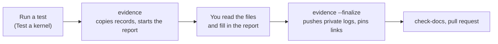

# Record an experiment

**Applies to:** any hardware run made with `./tools/asahi` ·
**Last verified:** 2026-10-18 with the tool's unit tests; not yet on a new
hardware run

Every hardware run you might cite later, pass or fail, becomes an experiment
report. Two commands do most of the work: `evidence` copies the run's
records and starts the report, and `evidence --finalize` publishes the
private logs and pins links to them. You fill in what only a person knows.



## Where evidence goes

This repository is public, so `evidence` splits a run in two:

| What | Where |
| --- | --- |
| The report and structured records (`boot.json`, `check.json`, driver checks, build summary), with identifiers redacted | This repository, `docs/experiments/SLUG/` |
| Logs (`serial.log`, `hv.log`, `guest-health.log`), the exact config, and source and workflow snapshots | The private [`asahi-sdp-evidence`](https://github.com/MagicCat3022/asahi-sdp-evidence) repository, `SLUG/RUN_ID/` |
| Binaries (kernel images, initramfs, ADT dumps) | Neither; local bundles, or SharePoint `03 Large artifacts/RUN_ID/` |

## One-time setup

Ask the repository owner to add you as a collaborator on
`asahi-sdp-evidence`, then clone it next to this checkout:

```bash
git clone https://github.com/MagicCat3022/asahi-sdp-evidence.git ~/Github/asahi-sdp-evidence
```

`./tools/asahi init` points `asahi.local.json` at that folder; see
[configuration](../reference/asahi-tool.md#configuration).

## 1. Before the run

Pick a short slug. The folder name is the UTC date of the first run plus the
slug, e.g. `docs/experiments/2026-10-21-hotplug-baseline/`. Add any new cable,
monitor, or adapter to [the hardware inventory](../reference/hardware.md).

## 2. Run it

Follow [Test a kernel](test-a-kernel.md). Write down anything physical the
tools can't see, with the time: "unplugged `CAB-02` at about 14:05, replugged
15 s later", and what was on screen. These become **manual** results.

## 3. Copy the evidence

**PC:**

```bash
git -C ~/Github/asahi-sdp-evidence pull
./tools/asahi evidence docs/experiments/2026-10-21-hotplug-baseline/evidence
```

This uses the latest run; add `--run-dir .asahi/runs/RUN_ID` for another one.
It copies the records and logs, and starts `README.md` from
[the template](../templates/experiment.md) with **Inputs** and the automated
**Results** filled in. For a second run in the same experiment, it prints
the rows to add instead of touching the report.

**Read what it wrote** before going on, including the private copies. The
tool redacts paths, the Mac's user and hostname, serial numbers, UUIDs,
machine IDs, and MAC addresses, but it can't know about everything:

```bash
grep -rniE "password|token|ssid|@" docs/experiments/2026-10-21-hotplug-baseline | less
```

Without access to the private repository, add `--skip-logs` and say in the
report that logs and inputs weren't archived.

## 4. Fill in the report

Replace every `FILL IN` (`check-docs.py` fails while any is left). Write the
**Goal** and **Procedure**, add a row for each manual check with who observed
it and when, and say plainly what you didn't test. Results use only
**PASS**, **FAIL**, **NOT TESTED**, or **BLOCKED**; for repeated tests, give
the rate, as in "FAIL 3/10". Quote the few log lines that matter in
**Observations**. Quoted lines become public, so read them first.

## 5. Publish the private evidence

**PC:**

```bash
./tools/asahi evidence docs/experiments/2026-10-21-hotplug-baseline/evidence --finalize
```

It lists the run's private files and asks before committing and pushing just
that folder. It then checks the pushed bytes against the copies and rewrites
`evidence/RUN_ID/logs.md` with links pinned to that commit. The report
already links to `logs.md`, so there is nothing to copy.

## 6. Failures, index, pull request

- If the run reproduced or explained a failure, update its entry in the
  [failure catalogue](../failures/README.md); if it found a new one, add one.
- Add a row to [experiments/README.md](../experiments/README.md).
- Run `python3 tools/check-docs.py` and open a pull request to `project`.

Once merged, the report is frozen. Fix a mistake with a dated line under
**Corrections**.

To rebuild a kernel from the private archives, see
[rebuilding from preserved inputs](../reference/asahi-tool.md#rebuilding-from-preserved-inputs).
