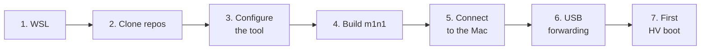
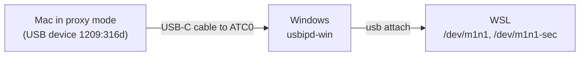

# Set up the controller PC

**Applies to:** Windows 11 with Ubuntu on WSL2, usbipd-win 5.x, m1n1
`ce2b8a43` · **Last verified:** 2026-10-14 on `PC-01` with `MAC-01`, except
that `PC-01` builds m1n1 with Clang ([below](#if-the-m1n1-build-fails)) and
hasn't run the GNU build in step 4; see
[2026-10-14-baseline-hv](../experiments/2026-10-14-baseline-hv/)

Do this once per PC, after [setting up the test Mac](set-up-the-test-mac.md).
It ends with your first hypervisor boot of the Mac's own kernel, which proves
every part works before you test anything new.



Commands are labelled with where they run: **PowerShell** (Windows),
**PC** (Ubuntu in WSL, from this repository's folder unless shown otherwise),
or **Mac**.

> **Native Linux PC instead of Windows?** Skip steps 1 and 6: with the cable
> plugged into the PC, `/dev/m1n1` appears directly. `setup-host` assumes
> Ubuntu or Debian. Nobody on the team has tried this yet, so record how it
> goes.

## Before you start

- The Mac is set up and you know its username and IP address.
- A **USB-C cable that carries data** (many charging cables don't).
- The PC has an ID in the [hardware inventory](../reference/hardware.md).

## 1. Install Ubuntu on WSL with systemd

**PowerShell:**

```powershell
wsl --install -d Ubuntu
```

**PC:** check that `/etc/wsl.conf` contains these lines, and add them if not:

```ini
[boot]
systemd=true
```

If you changed it, run `wsl --shutdown` in PowerShell and reopen Ubuntu.

## 2. Clone this repository and m1n1

**PC:**

```bash
git clone --single-branch --branch project \
  https://github.com/MagicCat3022/Asahi-Linux-Senior-Design-Project.git \
  ~/Github/Asahi-Linux-Senior-Design-Project
git clone --recursive https://github.com/AsahiLinux/m1n1.git ~/projects/m1n1
git -C ~/projects/m1n1 checkout ce2b8a43cea4220b602af1005dc9dbfc59c9624e
cd ~/Github/Asahi-Linux-Senior-Design-Project
```

`--single-branch` avoids downloading the kernel history from the other
branches. The m1n1 commit is the one we've tested. Newer ones probably work,
but record the commit you use in experiment reports.

## 3. Configure the tool

**PC:**

```bash
./tools/asahi init --target YOUR_USERNAME@MAC_IP
./tools/asahi setup-host
```

- `init` writes `asahi.local.json`, this PC's settings. Git ignores it, so
  your Mac's address never gets committed. To change a setting later, edit
  the file; don't rerun `init`. Every key is described in the
  [tool reference](../reference/asahi-tool.md#configuration).
- `setup-host` installs Ubuntu packages and m1n1's device rules, so
  `/dev/m1n1` appears with the right permissions. It uses `sudo`. If it says it
  added you to `dialout`, close Ubuntu and reopen it.

## 4. Build m1n1 and install uv

The PC runs m1n1's Python tools, which compile small ARM64 programs as they
go. They need a built m1n1 and an ARM64 toolchain (installed by
`setup-host`).

**PC:**

```bash
curl --proto '=https' --tlsv1.2 -sSf https://sh.rustup.rs | sh   # skip if you have rustup
rustup target add aarch64-unknown-none-softfloat
make -C ~/projects/m1n1
curl -LsSf https://astral.sh/uv/install.sh | sh
```

[uv](https://docs.astral.sh/uv/) runs m1n1's Python tools with the exact
package versions m1n1 lists, without touching the system Python.

### If the m1n1 build fails

`PC-01` uses Clang and LLD instead of the GNU tools. To do the same, build
with `make -C ~/projects/m1n1 USE_CLANG=1 TOOLCHAIN=/usr/lib/llvm-22/bin/`
and set `proxy_env` in `asahi.local.json` as shown in the
[tool reference](../reference/asahi-tool.md#m1n1-toolchain-on-the-pc).

## 5. Connect to the Mac

Boot the Mac normally. **PC:**

```bash
./tools/asahi authorize        # makes an SSH key and asks for the Mac password once
./tools/asahi discover         # records the Mac's board, disk, and boot settings
./tools/asahi capture          # copies the Mac's current kernel to the PC as the baseline bundle
./tools/asahi doctor --online  # checks everything; fix anything marked MISSING
```

`authorize` creates a key only for this workflow, `~/.ssh/asahi_hv`, and
copies its public half to the Mac. The private key never leaves the PC.

## 6. Forward the Mac's USB connection into WSL

WSL can't see USB devices on its own. usbipd-win passes the Mac's m1n1
connection through.



**PowerShell:** install usbipd-win:

```powershell
winget install --interactive --exact dorssel.usbipd-win
```

Connect the cable from the PC to the Mac's **ATC0** port: the rear USB-C port,
next to MagSafe on the MacBook Air M2
([decision 0002](../decisions/0002-proxy-on-atc0.md) explains why). Power the
Mac off, then hold the power button until startup options appear, and pick
the m1n1 entry. Then, in **PowerShell as administrator**:

```powershell
usbipd list                        # find the row with 1209:316d; note its BUSID, like 3-6
usbipd bind --busid YOUR_BUSID     # once per Windows USB port
```

**PC:** put that BUSID in `asahi.local.json` as `"usb_busid": "3-6"`, then
start forwarding in **its own terminal** and leave it running:

```bash
./tools/asahi usb attach
```

It reattaches whenever the Mac resets. The BUSID stays the same as long as
the cable stays in the same port on the PC; if you move it, run
`usbipd list` again.

## 7. Boot the baseline under the hypervisor

This boots the Mac's own kernel the same way you'll boot test kernels. If it
passes, the whole setup works. Turn the Mac off (it's still waiting in proxy
mode from step 6, so hold the power button). Keep `usb attach` running.
Then:

**PC:**

```bash
./tools/asahi session start --wait 600
```

Now power on the Mac, holding the power button, and pick the m1n1 entry. The
session sends the kernel as soon as the Mac appears. To watch it, run
`./tools/asahi session attach`, switch windows with `Ctrl-b n`, and detach with
`Ctrl-b d`. Detaching doesn't stop anything.

When Linux has booted, check it from another terminal:

**PC:**

```bash
./tools/asahi check --wait 180
```

You should see `PASS:` followed by the kernel version. Then shut the Mac down
and close the session:

```bash
./tools/asahi ssh -- sudo -n systemctl poweroff
./tools/asahi logs                     # the serial log should end with the shutdown
tmux kill-session -t asahi-hv
```

The `hv` window ends with `SerialException: device reports readiness to read
but returned no data` when the Mac powers off. That's expected.

## You're done when

- [ ] `./tools/asahi doctor --online` reports no `MISSING` items.
- [ ] `./tools/asahi check` printed `PASS` for a hypervisor boot.
- [ ] `./tools/asahi status` shows your baseline bundle and the run you
      just did.

If something went wrong, see
[Troubleshooting](../reference/asahi-tool.md#troubleshooting).

Next: [Test a kernel](test-a-kernel.md).
