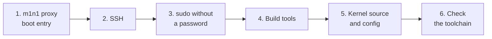

# Set up the test Mac

**Applies to:** MacBook Air M2 (J413) with Fedora Asahi 44, fairydust 7.1.x ·
**Last verified:** 2026-10-14 on `MAC-01`, except step 5's clone command,
which follows the README and wasn't rerun; see
[2026-10-14-baseline-hv](../experiments/2026-10-14-baseline-hv/)

Do this once per Mac. When you're done, the Mac can boot into m1n1 proxy mode,
accepts SSH from the controller PC, and can build kernels. The words used here
are explained in the [overview](../overview.md) and the
[glossary](../reference/glossary.md).



Commands are labelled with where they run: **macOS**, **Mac** (Fedora
Asahi, booted normally), or **PC** (Ubuntu in WSL).

## Before you start

- Asahi Linux (Fedora Asahi Remix) is installed and boots normally.
- The Mac is on the same network as the controller PC.
- The Mac has an ID in the [hardware inventory](../reference/hardware.md). If
  it doesn't, add a row now (for example `MAC-02`).

## 1. Add an m1n1 proxy boot entry

The PC can only send kernels to m1n1 when the Mac boots into proxy mode. The
simplest way is a second boot entry that starts m1n1 and waits for the PC.

**macOS:** run the Asahi installer, turn on expert mode when it asks, and
choose the option that installs **m1n1 only** (tethered boot):

```bash
curl https://alx.sh | sh
```

It adds an entry to the startup options menu (hold the power button at
startup). Your normal Asahi entry stays as it is. The
[Asahi tethered boot guide](https://asahilinux.org/docs/sw/tethered-boot/)
explains the options, including the alternative "stage-1 backdoor" in the
existing install. With the backdoor, opening the serial port in the first
five seconds of any boot interrupts it, and it needs a one-time recovery
setup. These guides assume the separate entry.

## 2. Turn on SSH

**Mac:**

```bash
sudo dnf install openssh-server
sudo systemctl enable --now sshd
whoami          # your username, for the PC setup
hostname -I     # the Mac's IP address, for the PC setup
```

If the PC's connection times out later and `firewalld` is running, allow the
`ssh` service in the zone for your network. Don't turn the firewall off.

## 3. Allow sudo without a password

`./tools/asahi` installs modules and reads `/boot` over SSH without a terminal
to type a password into, so it needs passwordless sudo.

**Mac:**

```bash
sudo visudo -f /etc/sudoers.d/99-asahi-workflow
```

Add this line, with your username, and save:

```text
YOUR_USERNAME ALL=(root) NOPASSWD: ALL
```

Check it with `sudo -k; sudo -n whoami`, which should print `root`.

> **This gives the account full root access without a password.** Only do it
> on a Mac used for development, and delete the file when the Mac stops being
> a test machine. Never put a password in a command, a file in this
> repository, or a chat.

## 4. Install the kernel build tools

Kernels are compiled on the Mac ([decision 0003](../decisions/0003-native-builds-on-mac.md)).

**Mac:**

```bash
sudo dnf install gcc make clang llvm lld clang-libs \
  bison flex bc openssl-devel elfutils-libelf-devel dwarves \
  perl python3 git pkgconf-pkg-config \
  zstd xz kmod dracut cpio diffutils findutils tar rsync \
  rust rust-src bindgen-cli
```

Also install `ncurses-devel` if you want `make menuconfig`.

If you use rustup instead of Fedora's Rust (check with `command -v rustc`: a
path under `~/.cargo/bin` means rustup), Fedora's `rust-src` doesn't match
it. Run `rustup component add rust-src` instead.

The versions we've tested are in the
[kernel config reference](../reference/kernel-config.md#tested-toolchain).

## 5. Get the kernel source and a working config

Keep one clean copy of the source on the Mac, in `~/linux-fairydust`. Each
test then gets its own worktree next to it (see
[Test a kernel](test-a-kernel.md#1-put-the-source-on-the-mac)).

**Mac:**

```bash
git clone --single-branch --branch fairydust \
  https://github.com/MagicCat3022/Asahi-Linux-Senior-Design-Project.git ~/linux-fairydust
cp /boot/config-$(uname -r) ~/linux-fairydust/.config
```

The second line copies the config of the kernel the Mac is running now. That
config is known to boot this Mac, so every test starts from it. Don't use
`make defconfig`, an `asahi.config` fragment, or a config from another
machine for kernels you boot; the
[kernel config reference](../reference/kernel-config.md) explains why.

## 6. Check the toolchain

**Mac:**

```bash
cd ~/linux-fairydust
make LLVM=1 rustavailable
```

It should end with `Rust is available!`. If it doesn't, the message says
what's missing. The usual cause is `rust-src` (see step 4).

## You're done when

- [ ] Holding the power button at startup shows an m1n1 entry next to your
      normal Asahi entry.
- [ ] `ssh YOUR_USERNAME@MAC_IP` works from the PC.
- [ ] `sudo -n whoami` prints `root` on the Mac.
- [ ] `make LLVM=1 rustavailable` passes in `~/linux-fairydust`.

Next: [Set up the controller PC](set-up-the-controller-pc.md).
