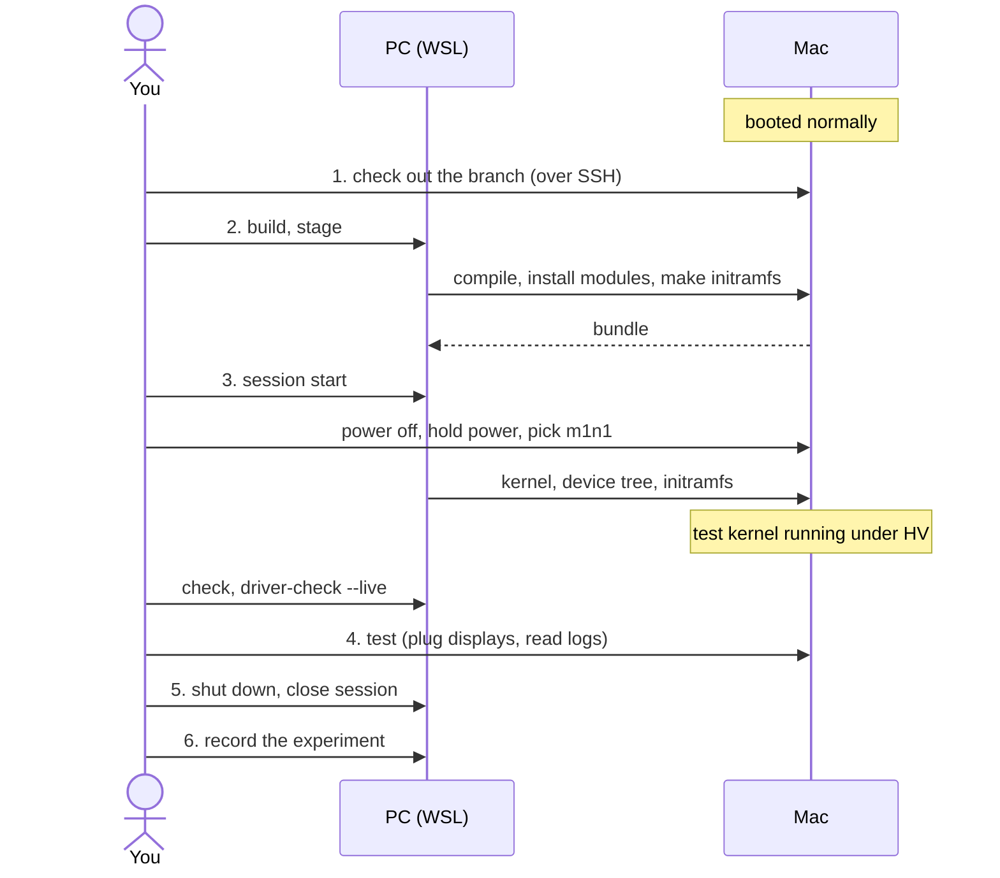

# Test a kernel

**Applies to:** MacBook Air M2 (J413), fairydust 7.1.x, driver profile
`j413-usbc-dp` · **Last verified:** 2026-10-14 on `MAC-01` and `PC-01`; see
[2026-10-14-tipd-oob-fixes](../experiments/2026-10-14-tipd-oob-fixes/)

The everyday loop: take a kernel branch, build it on the Mac, boot it under
the m1n1 hypervisor, check it, test it, and shut it down. It assumes both
machines are set up ([Mac](set-up-the-test-mac.md), [PC](set-up-the-controller-pc.md)).
[The overview](../overview.md) explains why it works this way.



Commands are labelled **PC** (Ubuntu in WSL, from this repository's folder)
or **Mac**. Not sure where you are? Run `./tools/asahi status`; its last line
says what to do next.

## 1. Put the source on the Mac

Each test gets its own **worktree**: a separate folder checked out from the
clean copy in `~/linux-fairydust`. Detaching it at an exact commit means the
test stays reproducible even if the branch moves on.

**PC:** open a shell on the Mac:

```bash
./tools/asahi ssh
```

**Mac:** set the two names, then fetch and check out the branch:

```bash
branch=tipd-oob-fixes                 # the branch on GitHub to test
tree=~/kernel-$branch                 # a new folder for this test

cd ~/linux-fairydust
git fetch --no-tags https://github.com/MagicCat3022/Asahi-Linux-Senior-Design-Project.git \
  "refs/heads/$branch:refs/remotes/sdp/$branch"
commit=$(git rev-parse "refs/remotes/sdp/$branch^{commit}")
git log -3 --oneline "$commit"        # is this what you expected?
git worktree add --detach "$tree" "$commit"
cp ~/linux-fairydust/.config "$tree/.config"
exit
```

- The `.config` copy is the Mac's known-good config from
  [setup](set-up-the-test-mac.md#5-get-the-kernel-source-and-a-working-config).
  Always start from it.
- If the folder already exists, look at it before reusing it. Don't reset a
  worktree that has someone else's changes in it.
- To write code rather than test a pushed branch, make a branch in the
  worktree: `git -C "$tree" switch -c usb/your-change`. For new work, start
  from `usb/dev` and target kernel pull requests there; see
  [branches and sync](../reference/branches-and-sync.md#start-a-kernel-branch).
- Read the kernel tree's own instructions before editing it, and see
  [CONTRIBUTING](../../CONTRIBUTING.md#upstream-contributions-and-ai-tools)
  about AI tools and upstream patches.

## 2. Build and stage

The Mac must be **booted normally** for this step. Quote the `~` so the PC's
shell doesn't expand it to your PC home folder.

**PC:**

```bash
./tools/asahi build --source '~/kernel-tipd-oob-fixes' --profile j413-usbc-dp --dry-run
./tools/asahi build --source '~/kernel-tipd-oob-fixes' --profile j413-usbc-dp --jobs 4
./tools/asahi stage
./tools/asahi driver-check
```

| Command | What it does | Takes |
| --- | --- | --- |
| `build --dry-run` | Checks the source, config, and Rust toolchain without compiling | Seconds |
| `build` | Compiles the kernel, device trees, and modules on the Mac with a new release name, like `7.1.13-fairydust-sdp-20261014t…` | 5–10 min in our runs so far; longer for the first build in a new folder |
| `stage` | Installs the new modules on the Mac (in their own folder), builds an initramfs, and copies the bundle to the PC | A few minutes |
| `driver-check` | Confirms the bundle has every module the profile needs, built for this exact release | Seconds |

**`--profile`** names a [driver profile](../reference/asahi-tool.md#driver-profiles).
`j413-usbc-dp` requires the USB-C display drivers to be enabled and puts them
in the initramfs. Leave out `--profile` and `driver-check` for tests that
don't involve USB-C displays. `stage` remembers the profile from `build`.

Each build gets a new release name, so it can never overwrite another
kernel's modules. To pick a recognizable one, add
`--localversion=-sdp-tipd-01`; it must be new.

## 3. Boot it under the hypervisor

### Use the right USB-C port

When the bundle has a driver profile, the proxy cable must be in the port the
profile names. For `j413-usbc-dp`:

| Connection | MacBook Air M2 port |
| --- | --- |
| Proxy cable to the PC | **ATC0**: rear USB-C, next to MagSafe |
| Display under test | **ATC1**: front USB-C |
| Power | MagSafe |

The hypervisor takes over the USB port the proxy cable uses, so Linux can't
use that port's PHY for a display.
If the cable is in the wrong port, the boot stops before the guest starts and says
which port to use. Only move the cable while the Mac is off.

### Boot

If a guest is still running from before, finish with
[step 5](#5-shut-down) first. Then, with the Mac **off** and
`./tools/asahi usb attach` running in its own terminal:

**PC:**

```bash
./tools/asahi session start --wait 600
```

Power on the Mac while holding the power button, and pick the **m1n1** entry.
The session boots the selected bundle (the one `stage` just made) as soon as
the Mac appears.

**PC:** watch it boot, then prove it's the right kernel:

```bash
./tools/asahi hv show                # recent hypervisor output, without attaching
./tools/asahi check --wait 180       # PASS only if this run's kernel booted from the usual disk
./tools/asahi driver-check --live    # the display drivers are loaded and bound to their devices
```

`check` only passes if the running kernel carries this run's marker, so an
older boot can't pass by accident. `driver-check --live` can pass with no
monitor connected. It checks that the drivers are ready, not that a picture
appears.

## 4. Test

Run the test your experiment plan calls for. Write down anything physical as
you go ("plugged `MON-01` into ATC1 at 14:05"); those become the **manual**
results in the report.

**PC:** useful commands while the guest runs:

| Command | Use |
| --- | --- |
| `./tools/asahi ssh -- sudo -n dmesg` | Full kernel log |
| `./tools/asahi driver-check --live` | Save connector state and modes (run it before and after each plug or unplug) |
| `./tools/asahi logs` | End of the serial and hypervisor logs |
| `./tools/asahi hv interrupt` | Pause the guest and open the hypervisor's Python shell |
| `./tools/asahi hv command bt` | Run one command in that shell (wait for its prompt first) |
| `./tools/asahi hv resume` | Let the guest continue |
| `./tools/asahi session attach` | Watch live; `Ctrl-b d` detaches without stopping anything |

> **Careful in the hypervisor shell.** Register writes, hooks, breakpoints,
> and `reboot` act on the real machine.

### Display hot-plug tests

1. With the guest running and `driver-check --live` passing, plug the display
   into **ATC1**. Use hardware IDs from the [inventory](../reference/hardware.md)
   in your notes. Add new cables, adapters, or monitors to it first.
2. Run `driver-check --live` after each plug and unplug.
3. Save `dmesg` at the end.

For more detail from the USB-C and display drivers, turn on their debug
messages (and turn them off afterwards with `-p` instead of `+p`):

**PC:**

```bash
./tools/asahi ssh -- sudo -n sh -c 'echo "module tps6598x_core +p" > /sys/kernel/debug/dynamic_debug/control'
./tools/asahi ssh -- sudo -n sh -c 'echo "module appledrm +p" > /sys/kernel/debug/dynamic_debug/control'
```

A log line saying a display was detected isn't proof that a picture
appeared. Record what you actually saw on the screen as a separate, manual
result. With no monitor available, record the boot and driver results and
mark hot-plug **NOT TESTED**.

## 5. Shut down

Shut the guest down from Linux. Don't just kill the session: if the
hypervisor stops while the guest runs, the guest freezes at its next trap.

**PC:**

```bash
./tools/asahi ssh -- sudo -n systemctl poweroff
./tools/asahi logs                   # wait until the serial log shows the shutdown
tmux kill-session -t asahi-hv        # only after the Mac is off
```

The `hv` window ends with a `SerialException` when the Mac powers off. That's
expected.

**If the test kernel won't boot:** power off, hold the power button, and pick
the normal Asahi entry. The Mac's installed kernel is untouched. To boot the
baseline under the hypervisor again, select it with `./tools/asahi bundles`
and `./tools/asahi use .asahi/bundles/BASELINE_FOLDER`.

## 6. Record it

Any run you might cite, pass or fail, becomes an experiment report. Follow
[Record an experiment](recording-an-experiment.md).

## Next build of the same branch

Edit in the same worktree and repeat from [step 2](#2-build-and-stage). The
build reuses earlier output, so it's much faster than the first time.
