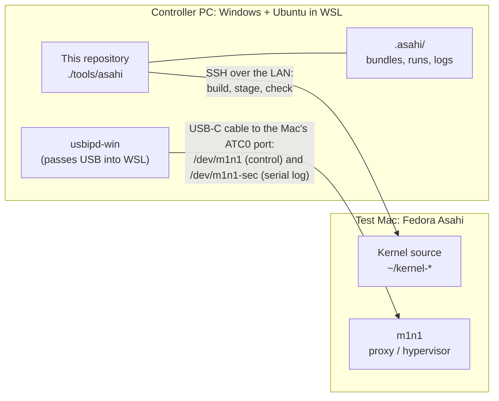
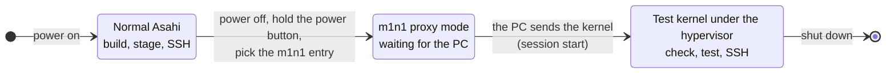
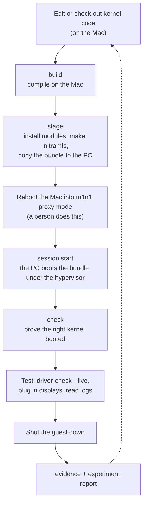

# How the project and the test setup work

Read this first. It explains what we're building, how a test kernel gets from
source code to a running Mac, and which machine does what. The guides then
give the exact commands. Unfamiliar words are in the
[glossary](reference/glossary.md).

## The project in one paragraph

Asahi Linux runs on Apple Silicon Macs, but external displays over USB-C
(DisplayPort "alt mode") are still unreliable on M1 and M2 machines. The
drivers involved are the USB-C port controller (TIPD), the port's PHY
(ATCPHY), and the display coprocessor (DCP). We change those drivers in
Asahi's `fairydust` kernel branch, boot the result on a real Mac, and record
what works and what fails. The [proposal](../deliverables/proposal/) has the
full plan.

## Why kernels are tested under a hypervisor

A broken kernel can hang at boot or leave the Mac unable to start Linux, and
installing every candidate as a normal kernel is slow. So we boot test kernels
under **m1n1**, Asahi's bootloader and hypervisor:

- The Mac starts m1n1 in **proxy mode** and waits for instructions over a
  USB-C cable.
- The PC sends m1n1 our kernel, and m1n1 runs it as a **guest** while
  logging everything to the PC.
- Outside your kernel source folder, the only change on the Mac's disk is a
  new, uniquely named folder of kernel modules. The Mac's normal boot files
  are never touched. If a test kernel breaks, power off and boot normally.

The guest uses the Mac's real hardware and its real Linux installation (same
disk, same files). It isn't a separate virtual machine.

## The two machines

- **SSH** is for everything that needs Linux running on the Mac: building,
  installing modules, and checking a booted kernel.
- **The USB-C cable** is for m1n1: sending the kernel and recording its
  console. The PC side sees two serial devices, `/dev/m1n1` and
  `/dev/m1n1-sec`.
- **Kernels are compiled on the Mac.** It's an ARM64 machine with the right
  toolchain, so builds match what runs
  ([decision 0003](decisions/0003-native-builds-on-mac.md)).
- **Everything is driven from the PC** with one tool, `./tools/asahi`, so any
  teammate or an AI assistant can run the same steps.

## The Mac's three states

Every test moves the Mac through these states. Most commands only work in
one of them, and the guides say which.

## One test, start to finish

The commands are in [Test a kernel](guides/test-a-kernel.md). At any point,
`./tools/asahi status` shows where you are and what to run next.

A **bundle** is the set of files the PC needs to boot a kernel: the kernel
image, the device tree, the initramfs, and checksums. The PC keeps every
bundle in `.asahi/bundles/`, including the **baseline** captured from the
Mac's installed kernel. Any of them can be booted again later.

## Where things are kept

| What | Where | In Git? |
| --- | --- | --- |
| Docs, tools, tests | This repository, `project` branch | Yes, public |
| Kernel changes | `work/*` branches of this repository, checked out on the Mac in `~/kernel-*` | Yes, public |
| Machine settings (Mac address, paths) | `asahi.local.json` on each PC | No |
| Bundles, run logs, build records | `.asahi/` on each PC | No |
| Run logs we cite | Private repository [`asahi-sdp-evidence`](https://github.com/MagicCat3022/asahi-sdp-evidence) | Yes, team only |
| Results | `docs/experiments/`, one report per test | Yes, public |

This repository is a public fork, so anything identifying (IP addresses,
usernames, serial numbers, raw logs) stays out of it.
`./tools/asahi evidence` handles that when you publish a run; see
[Record an experiment](guides/recording-an-experiment.md).

## Where to go next

1. [Set up the test Mac](guides/set-up-the-test-mac.md). This is done once per Mac.
2. [Set up the controller PC](guides/set-up-the-controller-pc.md). This is done once per PC, and ends with your first hypervisor boot.
3. [Test a kernel](guides/test-a-kernel.md), the everyday loop.
4. [Record an experiment](guides/recording-an-experiment.md) after any run worth citing.

For the full command list, config keys, and troubleshooting, see the
[`asahi` tool reference](reference/asahi-tool.md). To understand the drivers
themselves, start with the [research notes](research/README.md).
