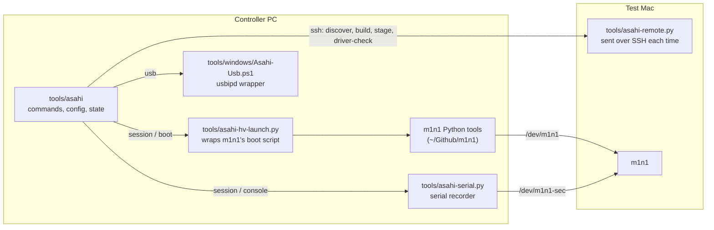

# The `asahi` tool

`./tools/asahi` runs the whole test workflow from the controller PC. This page
covers what it's made of, its settings and files, and what to do when
something fails. For the step-by-step order, follow the
[guides](../guides/README.md). For one command's options and examples, run
`./tools/asahi COMMAND --help`.

## How it's built



| File | Role |
| --- | --- |
| `tools/asahi` | The command-line tool. Everything starts here. |
| `tools/asahi-remote.py` | The code that runs on the Mac. It's sent over SSH on each call, so nothing is installed on the Mac. |
| `tools/asahi-hv-launch.py` | Starts m1n1's `run_guest_kernel.sh`. It checks the proxy port and raises m1n1's upload memory limit, without changing m1n1. |
| `tools/runtime/python3` | A small shim that lets the launcher take over the Python that m1n1's script calls. |
| `tools/asahi-serial.py` | Records the Mac's serial console to `serial.log` and reconnects after USB resets. |
| `tools/windows/Asahi-Usb.ps1` | Runs `usbipd` on Windows for the `usb` command. |
| `tools/profiles/*.json` | [Driver profiles](#driver-profiles). |
| `tools/check-docs.py` | Checks the docs; not part of the workflow. |

## Commands

The groups match `./tools/asahi --help`.

| Group | Commands |
| --- | --- |
| Anytime | `status`, `doctor`, `ssh`, `logs`, `bundles` |
| One-time setup | `init`, `setup-host`, `authorize`, `discover`, `capture`, `usb`, `adopt` |
| Build a kernel (Mac booted normally) | `build`, `stage`, `driver-check`, `use` |
| Test under the hypervisor (Mac in m1n1 proxy mode) | `session`, `check`, `hv`, `boot`, `console`, `proxy` |
| Record results | `evidence` |

`status` is the quickest way to get your bearings. It reads only local files,
so it's safe during a run, and `status --json` gives the same information for
scripts and AI assistants.

## Configuration

`asahi.local.json` in the repository root holds this PC's settings. `init`
creates it. Git ignores it. [`asahi.example.json`](../../asahi.example.json)
shows the shape.

| Key | Meaning | Default from `init` |
| --- | --- | --- |
| `target` | The Mac's SSH login, `USER@HOST`. Update it if the Mac's IP address changes. | from `--target` |
| `identity` | SSH key for this workflow | `~/.ssh/asahi_hv` |
| `m1n1_dir` | m1n1 checkout on the PC | `~/Github/m1n1` |
| `build_source` | Kernel source on the Mac, used when `build` has no `--source` | `~/linux-fairydust` |
| `make_args` | `make` arguments for every build | `["LLVM=1"]` |
| `proxy_env` | Toolchain for m1n1's Python tools; see [below](#m1n1-toolchain-on-the-pc) | not set (GNU tools) |
| `hv_heap_mib` | Memory m1n1 reserves for uploads, 128–2048 MiB; see [below](#upload-memory) | not set (512) |
| `bootargs` | Replaces the whole kernel command line. Normally unset; the tool builds it from `discover`. | not set |
| `proxy`, `console` | m1n1's control and serial-console devices | `/dev/m1n1`, `/dev/m1n1-sec` |
| `usb_busid` | Windows USB bus ID of the Mac's m1n1 device | from `--busid`, or `null` |
| `session` | tmux session name | `asahi-hv` |
| `bundle` | The selected bundle; `capture`, `stage`, and `use` set it | `hv-bundle` |
| `private_evidence_dir`, `private_evidence_url` | Clone and URL of the private evidence repository | the team's repository |

## Files the tool keeps

Everything lives under `.asahi/` in the repository root, which Git ignores.
Nothing in it is ever overwritten. Each build, bundle, and run gets a new
folder named after its UTC timestamp.

```text
.asahi/
  target.json              the Mac's board, root and EFI IDs, boot arguments (from discover)
  bundles/RELEASE-TIME/    one bootable bundle each; manifest.json has the checksums
  builds/TIME/             build.log, build.json, build-inputs.tar.gz, build-workflow.tar.gz
  latest-build.json        what stage will install next
  runs/RUN_ID/             one boot attempt each; see below
  latest-run.json          the run that check, logs, and evidence use by default
  driver-checks/TIME.json  driver-check reports
  locks/                   stops two programs from using the proxy port at once
```

Each run folder holds:

| File | Written by | Contents |
| --- | --- | --- |
| `boot.json` | `boot` | Bundle, release, kernel command line, m1n1 commit, workflow revision/checksums, and `state`: `planned`, `started`, or `exited` |
| `boot-workflow.tar.gz` | `boot` | Exact workflow tools and profiles, including local edits; private evidence only |
| `hv.log` | `boot` | Everything the hypervisor printed |
| `serial.log` | `console` | The Mac's serial console |
| `check.json` | `check` | What `check` found, and `passed` |
| `guest-health.log` | `check` | Kernel errors and failed services at check time. Read it; `check` doesn't judge it. |
| `proxy.log` | `proxy` | The interactive proxy shell |

These logs can contain identifiers, so they never go into this repository
as they are. [`evidence`](../guides/recording-an-experiment.md) publishes them
safely.

Build records include the workflow commit, dirty state, tool/profile hashes,
checksums of the input archives, and a `toolchain` object with Kbuild's selected
compiler, linker, Rust compiler, bindgen, and pahole commands and versions.
These versions are also included in exported build summaries; see
[recorded toolchain](kernel-config.md#recorded-toolchain).
`build-inputs.tar.gz` holds the final
`.config`, the tracked binary patch against the kernel commit, and non-ignored
untracked source files. `build-workflow.tar.gz` holds the tools actually used.
These archives remain exact and private; they are never redacted into public
records.

`evidence` copies the records and private files, saves the private files'
checksums in `private-evidence.json`, and starts the experiment report if it
doesn't exist. `--finalize` shows the run's uncommitted private files and,
after you confirm (or with `--yes`), commits just that folder and pushes it.
It then verifies the committed bytes and that the commit is on the private
remote, and writes commit-pinned private URLs to `logs.md`. Finalization
does not recopy evidence or retarget an already pinned record. `--skip-logs`
omits both private logs and exact inputs; say so in the report.

### Rebuilding from preserved inputs

For new builds, `build-inputs.tar.gz` contains `.config` after `olddefconfig`,
a binary-capable `source.patch` against the recorded kernel commit, and
non-ignored untracked source under `untracked/` (including modes and symlinks).
Start from that commit, apply `source.patch` if it isn't empty, copy the
untracked files back to their original paths, and put `.config` in the build
output folder. Use the recorded make arguments and toolchain versions.

`build-workflow.tar.gz` and `boot-workflow.tar.gz` contain the workflow tools
and profiles actually used at each step, including local edits. Their records
give the project commit, whether tool files were dirty, and file checksums.
`kernel.config` is also kept from a verified bundle when available.

The archives are inputs, not a complete toolchain or operating-system image.
Ignored source dependencies, signing material, firmware, and initramfs
packages can change the result, so keep the original bundle when the exact
binary matters.

## What `check` proves

`check` prints `PASS` only when all of these hold:

- the kernel command line has this run's marker (`asahi_sdp.run=RUN_ID`), so
  an older boot can't pass;
- the running release is the bundle's release;
- the root file system is the one `discover` recorded;
- the release's modules are installed, and SSH is running.

It doesn't check that drivers work. `driver-check --live` does that for a
profile's drivers. `check --running` checks a normal boot and never counts as
a hypervisor result.

## Safety rules built into the tool

- Every build gets a new release name, and `stage` refuses to write over an
  existing `/lib/modules/RELEASE`.
- Nothing writes to `/boot`, the Mac's boot entries, or m1n1's installation.
  `capture` and `discover` only read them.
- `stage` refuses if the source or build output changed after `build`.
- Only one program can use the proxy port at a time.
- Bundles are checked against their checksums and the Mac's board before
  every boot.
- If a bundle has a driver profile, the boot stops when the proxy cable is in
  the wrong port.

## Driver profiles

A profile describes what one kind of test needs. `build --profile` fails if
the config lacks it, `stage --profile` puts its modules in the initramfs, and
`driver-check` checks it before and after boot. The tool lists every file in
`tools/profiles/`, so adding a profile needs no code change.

```json
{
  "name": "j413-usbc-dp",
  "description": "USB-C DisplayPort drivers on the MacBook Air M2 (J413)",
  "board": "MacBook Air M2 (J413)",
  "compatible": "apple,j413",
  "proxy_iodev": 4,
  "proxy_port": "ATC0, the left rear USB-C port next to MagSafe",
  "options": { "CONFIG_TYPEC_TPS6598X": "tps6598x", "CONFIG_APPLE_RTKIT": null },
  "bindings": { "platform/apple-dcp": "271c00000.dcp" },
  "pd_address": "003f"
}
```

| Key | Meaning |
| --- | --- |
| `name` | Same as the file name |
| `compatible` | The board it's for, as `discover` reports it. A profile for another board is refused. |
| `proxy_iodev`, `proxy_port` | The m1n1 port the proxy cable must use, and a description for people. Optional; leave both out if any port works. |
| `options` | Config options that must be `y` or `m`, each with its module name (`null` if it's never a module) |
| `bindings` | `driver/device` pairs that must be bound in the running guest (`driver-check --live`) |
| `pd_address` | I²C address of the USB-C controller under test |

To add one for another Mac, copy the J413 profile and change the board, port,
and devices to match that Mac's device tree. Then run `build --dry-run` and
`driver-check` against it, and say in the report that the profile is new.

## m1n1 toolchain on the PC

m1n1's Python tools compile small ARM64 programs while they run, so the PC
needs an ARM64 compiler even though m1n1 itself is already built. By default
they use the GNU cross tools from `setup-host`. To use Clang and LLD instead,
as `PC-01` does:

```json
"proxy_env": {
  "USE_CLANG": "1",
  "TOOLCHAIN": "/usr/lib/llvm-22/bin/",
  "LLDDIR": "~/.local/lld-shim/"
}
```

`LLDDIR` is the folder that holds a working `ld.lld`. `doctor` reports the
toolchain it found and fails if any part is missing.

## Upload memory

m1n1's boot script reserves 128 MiB to receive the kernel and initramfs. Our
initramfs can be bigger than that, so the launcher raises it to
`hv_heap_mib` (512 MiB by default) without changing m1n1. The value is saved
in `boot.json`. A larger value leaves less memory for the guest.

## Changing the tool

Run the tests after any change to `tools/` or `tests/`. They need no Mac, and
CI runs them on every pull request:

```bash
python3 -m unittest discover -s tests
```

The two serial-console tests are skipped unless `pyserial` is installed.
The tests cover argument handling, archive and checksum safety, refusal to
overwrite modules, wrong-boot detection, serial reconnects, evidence
redaction, profiles, `status`, and that every command has help text and
examples. They don't test anything on hardware.

Things to keep when editing:

- **The launcher replaces itself** (`exec`) with m1n1's script, so Ctrl-C
  reaches only the hypervisor shell. A waiting Python parent would also get
  Ctrl-C and kill the hypervisor while the guest runs.
- **Settings go to the Mac on standard input**, never inside the shell
  command, because they can be large and contain paths.
- **New commands** need an entry in `COMMANDS` and `GROUPS` in `tools/asahi`
  (a test enforces this), a row in the [table above](#commands), and help text
  on every option.

## Troubleshooting

| Symptom | Cause | Fix |
| --- | --- | --- |
| `ssh: connect to host … timed out` | Mac is off, asleep, on another network, or its IP changed | Check `hostname -I` on the Mac and update `target` in `asahi.local.json`. If `firewalld` is on, allow `ssh`. |
| `Remote … failed … Check SSH/key/sudo access` | Passwordless sudo is missing | See [Mac setup step 3](../guides/set-up-the-test-mac.md#3-allow-sudo-without-a-password). |
| `/dev/m1n1` absent | Mac isn't in proxy mode, or USB isn't forwarded | Boot the m1n1 entry; check that `./tools/asahi usb attach` is running and `usbipd list` shows the device as attached. |
| `Proxy/console not ready` | The session's wait ran out before the Mac reached proxy mode | `tmux kill-session -t asahi-hv`, then `session start --wait 600` and boot the Mac sooner. |
| `Session already exists` | An earlier session is still open | Run `./tools/asahi status`. If its `hv` window has exited, `tmux kill-session -t asahi-hv`. If a guest is running, shut it down first. |
| `Another workflow process owns the proxy/HV` | Something else has `/dev/m1n1` open | Use `hv` commands on the running session, or close the other program (an old `proxy`, `picocom`, or `screen`). |
| `Proxy is on iodev 5; … requires iodev 4` | Proxy cable in the wrong Mac port for this profile | Power off, move the Mac end of the cable to the named port, and boot m1n1 again. If that port doesn't show up, restart into proxy mode with the cable already in place. |
| `SerialException: device reports readiness to read but returned no data` | The USB link dropped | Expected when the Mac powers off. In the middle of a run, check the cable and the `usb attach` terminal. |
| `SSH reached an older/different boot` from `check` | You reached the Mac's normal boot, not this run | Make sure the m1n1 entry was picked and the session's `hv` window booted the guest. |
| `Rust` errors from `build --dry-run` | rustup is missing `rust-src` | `./tools/asahi ssh -- rustup component add rust-src` |
| `Refusing to overwrite installed modules` | That release name is already installed | Build again; each build gets a new name. Don't reuse `--localversion`. |
| `stage` failed partway | A new `/lib/modules/RELEASE` folder may be left behind | Build again with a new name, or carefully remove only that failed folder. |
| `Host ARM64 stub toolchain failed` | m1n1's tools can't find an ARM64 compiler | Run `setup-host`, or set [`proxy_env`](#m1n1-toolchain-on-the-pc). |
| `Driver profile needs enabled options` | The config lacks a profile option | Turn it on with `make LLVM=1 menuconfig` in the worktree, then rebuild. |
| `Permission denied` on `/dev/m1n1` | You're not in `dialout` yet | Close and reopen Ubuntu after `setup-host`. |

When the test kernel won't boot at all: power off, hold the power button, and
pick the normal Asahi entry. Nothing it needs has changed.
