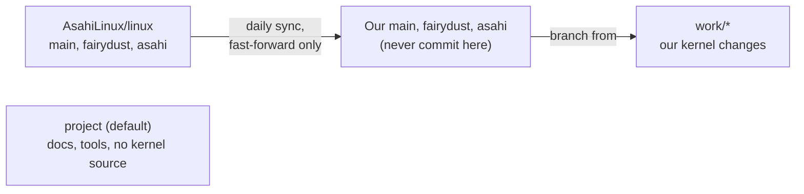

# Branches and the upstream sync

This repository is a fork of [AsahiLinux/linux](https://github.com/AsahiLinux/linux).
It holds two kinds of branches: copies of upstream that a GitHub Action keeps
current, and our own.



| Branch | Contents | Updated by |
| --- | --- | --- |
| [`main`](https://github.com/MagicCat3022/Asahi-Linux-Senior-Design-Project/tree/main) | Copy of `AsahiLinux/linux:main` | Daily sync |
| [`fairydust`](https://github.com/MagicCat3022/Asahi-Linux-Senior-Design-Project/tree/fairydust) | Copy of `AsahiLinux/linux:fairydust`, where the newest USB-C display work is | Daily sync |
| [`asahi`](https://github.com/MagicCat3022/Asahi-Linux-Senior-Design-Project/tree/asahi) | Copy of `AsahiLinux/linux:asahi`, upstream's default | Daily sync |
| `project` (default) | Docs, tools, tests, and the sync workflow; no kernel source | The team, through pull requests |
| `work/*` | Our kernel changes, for example `work/fairydust-usb` | The team |

`project` has its own history, unrelated to the kernel's. It's the default
branch because GitHub runs scheduled workflows from the default branch, and
keeping the workflow there leaves the three copies identical to upstream.

## Start a kernel branch

Kernels you boot on the Mac are built on the Mac
([decision 0003](../decisions/0003-native-builds-on-mac.md)), so clone there,
or on any Linux machine for editing:

```sh
git clone --single-branch --branch fairydust \
  https://github.com/MagicCat3022/Asahi-Linux-Senior-Design-Project.git linux-fairydust
cd linux-fairydust
git remote add upstream https://github.com/AsahiLinux/linux.git
git switch -c work/fairydust-usb
git push -u origin work/fairydust-usb
```

`--single-branch` skips the other kernel branches, though the history is
still large. Use `asahi` or `main` in place of `fairydust` if that's the
right base. To test the branch, see [Test a kernel](../guides/test-a-kernel.md).

Bring in later upstream changes when you choose to:

```sh
git fetch upstream fairydust
git switch work/fairydust-usb
git merge FETCH_HEAD
```

If upstream rewrote its history, a merge may not make sense; rebase or
cherry-pick instead, and test before pushing.

## How the sync works

The [sync workflow](../../.github/workflows/sync-upstream.yml) runs daily at
**09:17 UTC** (5:17 a.m. EDT, 4:17 a.m. EST). It also runs when its own file
changes on `project`, and by hand from **Actions → Sync upstream kernel
branches → Run workflow** on the `project` branch.

It updates each copy through GitHub's API with `force: false`, using the
built-in `GITHUB_TOKEN` (`contents: write`). It needs no kernel checkout and
no personal token.

- A branch only moves forward if the update is a fast-forward.
- If someone committed to a copy, or upstream force-pushed, that branch's job
  fails and nothing is overwritten. The other branches still sync.
- A deleted branch or a permissions error fails visibly. Nothing is recreated
  or reset automatically.
- `project` and `work/*` are never touched.

**When a sync job fails:** open the failed job in Actions. Save any of our
commits on that branch to a `work/*` branch, look at what upstream did, and
then decide how to reset the copy. The workflow leaves that decision to a
person.

GitHub may delay scheduled runs, and it turns off schedules in public
repositories after **60 days without activity**. If that happens, turn the
workflow back on in Actions. See
[GitHub's schedule documentation](https://docs.github.com/en/actions/reference/workflows-and-actions/events-that-trigger-workflows#schedule).
