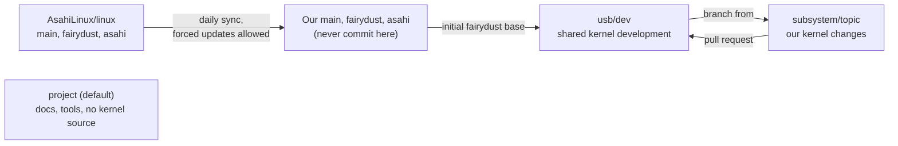

# Branches and the upstream sync

This repository is a fork of [AsahiLinux/linux](https://github.com/AsahiLinux/linux).
It holds two kinds of branches: copies of upstream that a GitHub Action keeps
current, and our own.



| Branch | Contents | Updated by |
| --- | --- | --- |
| [`main`](https://github.com/MagicCat3022/Asahi-Linux-Senior-Design-Project/tree/main) | Copy of `AsahiLinux/linux:main` | Daily sync |
| [`fairydust`](https://github.com/MagicCat3022/Asahi-Linux-Senior-Design-Project/tree/fairydust) | Copy of `AsahiLinux/linux:fairydust`, where the newest USB-C display work is | Daily sync |
| [`asahi`](https://github.com/MagicCat3022/Asahi-Linux-Senior-Design-Project/tree/asahi) | Copy of `AsahiLinux/linux:asahi`, upstream's default | Daily sync |
| `project` (default) | Docs, tools, tests, and the sync workflow; no kernel source | The team, through pull requests |
| [`usb/dev`](https://github.com/MagicCat3022/Asahi-Linux-Senior-Design-Project/tree/usb/dev) | Shared USB-C and display development, initially based on `fairydust` | Kernel pull requests |
| `<subsystem>/<topic>` | Our kernel changes, for example `usb/tipd-hpd-fix` or `drm/dcp-hotplug` | The topic's owner |

`project` has its own history, unrelated to the kernel's. It's the default
branch because GitHub runs scheduled workflows from the default branch, and
keeping the workflow there leaves the three copies identical to upstream.

`usb/dev` was created from `fairydust` at
[`ce9f2eba72c061a50b2d790450e90af3439d8c24`](https://github.com/MagicCat3022/Asahi-Linux-Senior-Design-Project/commit/ce9f2eba72c061a50b2d790450e90af3439d8c24)
(Linux 7.1.13). It is the target for our kernel pull requests. The daily sync
does not update it; the team brings in later upstream changes deliberately.

## Start a kernel branch

Kernels you boot on the Mac are built on the Mac, so clone there, or on any
Linux machine for editing:

```sh
git clone --single-branch --branch usb/dev \
  https://github.com/MagicCat3022/Asahi-Linux-Senior-Design-Project.git linux-sdp
cd linux-sdp
git remote add upstream https://github.com/AsahiLinux/linux.git
git switch -c usb/tipd-hpd-fix
git push -u origin usb/tipd-hpd-fix
```

`--single-branch` skips the other kernel branches, though the history is
still large. Use `<subsystem>/<topic>` names: a subsystem such as `usb`,
`drm`, or `phy`, followed by a short lowercase topic with hyphens between
words. Open kernel pull requests against `usb/dev`. Existing branch names
such as `tipd-oob-fixes` stay valid for their open reviews and experiment
links; use the new convention for new branches. To test the branch, see
[Test a kernel](../guides/test-a-kernel.md).

Bring the shared development branch into a topic when you choose to:

```sh
git fetch origin usb/dev
git switch usb/tipd-hpd-fix
git merge FETCH_HEAD
```

To update `usb/dev` from upstream, the team prepares and reviews an
integration branch based on the new `fairydust`. If upstream rewrote its
history, a merge may not make sense; rebase or cherry-pick the team's
changes instead, and test before updating the shared branch.

## How the sync works

The [sync workflow](../../.github/workflows/sync-upstream.yml) runs daily at
**09:17 UTC** (5:17 a.m. EDT, 4:17 a.m. EST). It also runs when its own file
changes on `project`, and by hand from **Actions → Sync upstream kernel
branches → Run workflow** on the `project` branch.

It updates each copy through GitHub's API with `force: true`, using the
built-in `GITHUB_TOKEN` (`contents: write`). It needs no kernel checkout and
no personal token.

- Each branch is set to the upstream commit read at the start of its job,
  even if upstream rewrote history. Any commits made directly on a copy
  are removed from that branch. Keep development on `usb/dev` and topic
  branches.
- The update includes the copy's previous commit as `beforeOid`, an atomic
  guard against concurrent changes. If the copy changes after the job reads
  it, the update fails. Other branches still sync.
- A deleted branch or a permissions error fails visibly. Nothing is recreated
  automatically. Branch protection must permit forced updates by the job.
- Only `main`, `fairydust`, and `asahi` can be updated. `project`, `usb/dev`,
  and topic branches are never touched.

The guard uses GitHub's [`updateRefs` mutation](https://docs.github.com/en/graphql/reference/git#updaterefs).
Each successful job records the previous and upstream commits in its summary.
Those hashes are an audit trail, not a backup: the job does not create an
archive branch, and commits without another reference may eventually become
unavailable. Preserve anything needed on a topic branch before the next sync.

`usb/dev` and existing topic branches keep their commits when a mirror is rewritten,
but may need a rebase or cherry-pick to adopt the new upstream history.
For a local mirror checkout, fetch and reset it to `origin/<branch>` after
saving any local work; a normal pull may fail or merge the old history back in.

**When a sync job fails:** open the failed job in Actions. For a concurrent
update, preserve any accidental commits on a topic branch, then rerun. For a
permissions or protection error, correct the repository settings. An
upstream force-push alone no longer needs manual intervention.

GitHub may delay scheduled runs, and it turns off schedules in public
repositories after **60 days without activity**. If that happens, turn the
workflow back on in Actions. See
[GitHub's schedule documentation](https://docs.github.com/en/actions/reference/workflows-and-actions/events-that-trigger-workflows#schedule).
